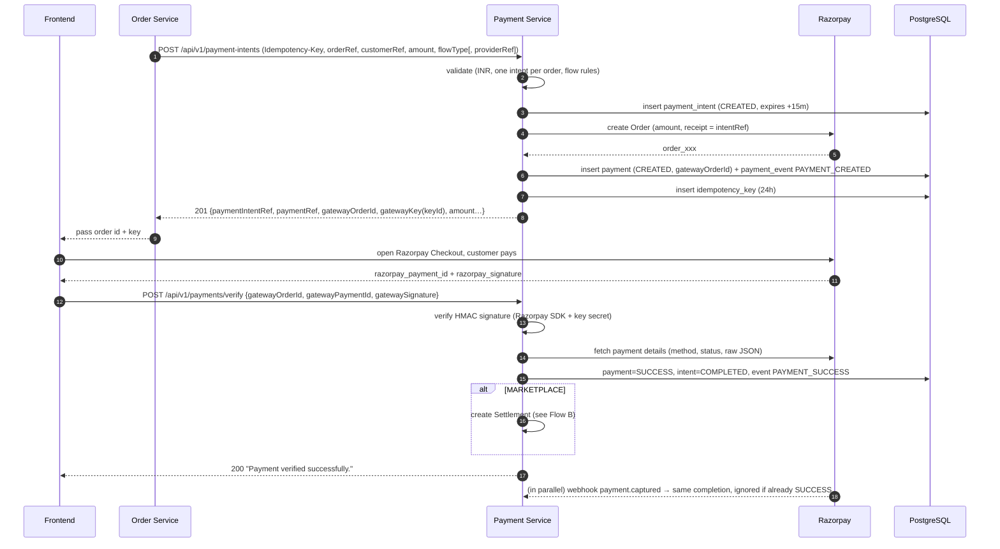

# StreamHub Payment Service — Complete Project Documentation

> Written from the actual source code in `payment-service/` (Spring Boot 3.5.11, Java 21, PostgreSQL, Flyway, Razorpay + RazorpayX).
> Purpose: a single document you can come back to months later and fully understand **what you built, why each table exists, how the tables relate, and how money moves through the system.**

---

## Table of Contents

1. [What you built (the big picture)](#1-what-you-built-the-big-picture)
2. [Key concepts & vocabulary (read this first)](#2-key-concepts--vocabulary)
3. [Tech stack & configuration](#3-tech-stack--configuration)
4. [Project structure (package map)](#4-project-structure)
5. [Architecture & layering](#5-architecture--layering)
6. [Database & entity relationships (ER diagram)](#6-database--entity-relationships)
7. [Every entity explained (what it is, why it exists)](#7-every-entity-explained)
8. [Enums & state machines](#8-enums--state-machines)
9. [Complete flows, end to end](#9-complete-flows-end-to-end)
10. [Webhooks (how Razorpay talks back to you)](#10-webhooks)
11. [Idempotency (safe retries)](#11-idempotency)
12. [Wallet accounting rules (balances, holds, ledger)](#12-wallet-accounting-rules)
13. [REST API reference](#13-rest-api-reference)
14. [Error handling](#14-error-handling)
15. [Design decisions & patterns used](#15-design-decisions--patterns-used)
16. [How to run & test locally](#16-how-to-run--test-locally)
17. [Things I noticed in the code (bugs, gaps, TODOs)](#17-things-i-noticed-in-the-code)
18. [Quick "where do I look?" cheat-sheet](#18-cheat-sheet)

---

## 1. What you built (the big picture)

You built **a standalone Payment Microservice** (`payment-service`, port **8083**) for a platform called **StreamHub**. Other services (orders, users, appointments, etc.) call it over REST whenever money needs to move. It hides all the Razorpay details behind clean APIs.

It handles **five kinds of money movement**:

| # | Capability | Direction | Razorpay product | In plain words |
|---|----------- |-----------|------------------|----------------|
| 1 | **Pay-in** (Payment Intent → Payment) | Customer ➜ Platform | Razorpay Payments (Orders + Checkout) | A customer pays for something. |
| 2 | **Settlement** | Inside your system | none (pure bookkeeping) | After a *marketplace* payment, split the money: provider's share goes to the provider's **wallet**; the rest is platform commission. |
| 3 | **Refund** | Platform ➜ Customer | Razorpay Refunds | Give a customer their money back (fully or partially). On success the refund amount is also credited to the customer's **wallet**. |
| 4 | **Wallet** | Internal ledger | none | Every provider / customer has an internal balance (available, pending, totals) with a full transaction history. |
| 5 | **Payout** | Platform ➜ Provider's bank/UPI | **RazorpayX** (Contacts, Fund Accounts, Payouts) | The provider withdraws wallet money to their real bank account / UPI. |

Plus supporting pieces: **Beneficiary & Fund Account** management (who gets paid and where), **Webhooks** (Razorpay → you), **Idempotency** (safe retries), **event/audit tables** (history of everything), global **error handling**.

### The 30-second story

```
Customer pays  ──►  Payment Intent + Razorpay Order created
                       │  (frontend opens Razorpay Checkout)
                       ▼
        Payment verified (signature)  /  webhook payment.captured
                       │
          ┌────────────┴─────────────┐
     DIRECT flow                MARKETPLACE flow
     (money is yours)           Settlement: 80% ➜ provider wallet, 20% commission
                                           │
                       Provider asks for withdrawal
                                           ▼
                Wallet HOLD (reserve) ➜ RazorpayX Payout ➜ bank
                                           │
                    webhook payout.processed ➜ hold RELEASED (money really left)
                    webhook payout.failed    ➜ hold CANCELLED (money returned to wallet)

Refund:  API ➜ Razorpay refund ➜ webhook refund.processed ➜ refund SUCCESS + customer wallet CREDIT
```

---

## 2. Key concepts & vocabulary

| Term | Meaning in this project |
|------|------------------------|
| **Reference** (e.g. `paymentReference`) | A public, system-generated **ULID** (26 chars, time-sortable, e.g. `01HZX...`). Every table has `id` (internal BIGINT, never exposed) **and** a `*_reference` (safe to expose in APIs). |
| **ULID** | Like a UUID but sortable by time & shorter (26 chars). Generated by `UlidGenerator` (lib `ulid-creator`). |
| **Amount in smallest unit** | All money is stored as `BIGINT` in **paise** (₹1 = 100). `Long amount = 50000` means ₹500.00. No floating point → no rounding errors. |
| **Payment Intent** | "The customer *intends* to pay ₹X for order Y." The *business request*. Created first. |
| **Payment** | The actual attempt/transaction at the gateway (linked to a Razorpay **order**, later a Razorpay **payment id**). |
| **Gateway** | The payment provider (only `RAZORPAY` today, but code is abstracted for others). |
| **Gateway Order ID** (`order_xxx`) | Razorpay's order; frontend needs it to open Checkout. |
| **Gateway Payment ID** (`pay_xxx`) | Razorpay's id for the real payment after the customer pays. |
| **Capture** | Money actually collected. Your app uses **auto-capture**, so `payment.captured` is the success signal. |
| **Payment Flow Type** | `DIRECT` (money simply belongs to the platform) or `MARKETPLACE` (money must be split to a provider). |
| **Owner** | Anyone who can own a wallet/beneficiary, identified by `(ownerReference, ownerType)`. |
| **Beneficiary** | A person/business that can **receive bank payouts**. Mirrors a **Razorpay Contact**. |
| **Fund Account** | A beneficiary's bank account or UPI id. Mirrors a **Razorpay Fund Account**. |
| **Wallet** | Internal balance for an owner. Holds `availableBalance`, `pendingBalance`, totals. |
| **Wallet Hold** | Temporary reservation of wallet money while a payout is in flight. |
| **Wallet Transaction** | One immutable ledger row per balance change (credit/debit). |
| **Settlement** | Bookkeeping record: "payment P (gross) → commission + net credited to wallet W". |
| **Payout** | Real outgoing bank transfer via RazorpayX. |
| **UTR** | Unique Transaction Reference – the bank's id for a completed transfer (stored on payouts). |
| **Webhook** | Razorpay calling *your* `/api/v1/webhooks/razorpay` URL to tell you something happened. |
| **Idempotency key** | Client-supplied `Idempotency-Key` header so retrying a request never creates duplicates. |
| **Event table** | Append-only history table (`payment_events`, `refund_events`, …) – never updated, only inserted. |
| **Soft reference** | A column holding another module's reference **without** a DB foreign key (deliberate; see §7/§15). |

---

## 3. Tech stack & configuration

**Stack** (from `pom.xml`)

| Item | Version / Detail |
|------|------------------|
| Spring Boot | 3.5.11 |
| Java | 21 |
| Database | PostgreSQL (driver `postgresql`) |
| Migrations | Flyway (`flyway-core`, `flyway-database-postgresql`) – 21 migration files `V1`–`V21` |
| ORM | Spring Data JPA / Hibernate (`ddl-auto: validate` – Hibernate only *checks* schema; **Flyway owns the schema**) |
| Validation | `spring-boot-starter-validation` (Jakarta Bean Validation) |
| Razorpay | `razorpay-java` 1.4.8 (Orders, Payments, Refunds, signature utils) |
| RazorpayX | Called manually using Spring `RestClient` + Basic Auth (the SDK doesn't cover it) |
| IDs | `ulid-creator` 5.2.3 |
| Boilerplate | Lombok |
| Scheduling | `@EnableScheduling` (one job: idempotency cleanup) |

**Config** (`application.yaml` / `application-dev.yaml`, active profile = `dev`)

```yaml
server.port: 8083
spring.datasource.url: jdbc:postgresql://localhost:5432/payment_service
spring.jpa.hibernate.ddl-auto: validate      # schema is controlled ONLY by Flyway
spring.jpa.open-in-view: false
spring.flyway.locations: classpath:db/migration

razorpay.key-id / key-secret / webhook-secret   # ← secrets (do NOT commit real ones)
razorpay.base-url: https://api.razorpay.com/v1
razorpayx.source-account-number: <your RazorpayX account no.>   # the account payouts are sent FROM
idempotency.cleanup.cron: "0 0 2 * * ?"        # daily at 02:00
```

> ⚠️ Your `application-dev.yaml` contains real-looking credentials. Move them to environment variables (`RAZORPAY_KEY_ID=...`) and rotate any key that was ever committed/shared (this zip included).

Hard-coded business constants:

| Constant | Where | Value |
|----------|-------|-------|
| Only currency supported | `CurrencyConstants.INR` | `INR` |
| Payment intent expiry | `PaymentIntentServiceImpl` | now + **15 min** |
| Platform commission | `SettlementServiceImpl.PLATFORM_COMMISSION_PERCENT` | **20 %** |
| Wallet hold expiry | `WalletServiceImpl.buildWalletHold` | now + **30 min** |
| Idempotency key lifetime | `IdempotencyServiceImpl.EXPIRATION_HOURS` | **24 h** |
| Payout `queue_if_low_balance` | `GatewayPayoutMapper` | always `true` |

---

## 4. Project structure

Package root: `com.streamhub.payment`. The code is **organised by feature (module)**, and each module repeats the same internal layout.

```
com.streamhub.payment
├── PaymentServiceApplication.java        # @SpringBootApplication + @EnableScheduling
│
├── payment/        ← PAY-IN module (Payment Intent, Payment, Payment Events)
├── refund/         ← REFUND module
├── settlement/     ← SETTLEMENT module (split a marketplace payment into wallet credit)
├── wallet/         ← WALLET module (wallet, transactions, holds)
├── beneficiary/    ← BENEFICIARY + FUND ACCOUNT module (who gets paid, where)
├── payout/         ← PAYOUT module (wallet ➜ bank via RazorpayX)
├── webhook/        ← Webhook receiver & router (Razorpay ➜ us)
├── gateway/        ← Everything that talks to Razorpay (SDK + RestClient)
├── idempotency/    ← Idempotency key storage/validation
└── common/         ← Base entities, exceptions, error handler, ULID util, constants, scheduler
```

Each feature module uses the same sub-packages:

```
<module>/
├── controller/   REST endpoints (thin: validate input, call service)
├── service/      interface  +  service/impl/  implementation (business rules)
├── repository/   Spring Data JPA interfaces (DB access)
├── entity/       JPA entities (tables)
├── dto/          request/ and response/ objects (what APIs accept/return)
├── mapper/       entity ⇄ DTO conversion
├── enums/        statuses, types, sources
└── (validation/, util/ … where needed)
```

`db/migration/` holds the Flyway SQL files; `docs/` holds your earlier per-module notes.

---

## 5. Architecture & layering

```
        Other microservices / Frontend / Razorpay (webhooks)
                              │ HTTP
                              ▼
 ┌────────────────────────────────────────────────────────────┐
 │ Controller        (validation annotations, HTTP status)    │
 ├────────────────────────────────────────────────────────────┤
 │ Service           (ALL business rules, @Transactional)     │
 │      │   ▲                                                 │
 │      │   └── Mapper (Entity ⇄ DTO)                         │
 │      ▼                                                     │
 │ Repository ──► PostgreSQL (Flyway-managed schema)          │
 │      │                                                     │
 │      ▼                                                     │
 │ Gateway layer:  RazorpayService (interface)                │
 │                   └ RazorpayServiceImpl                    │
 │                        ├ Razorpay Java SDK  (orders, payments, refunds, signatures)
 │                        └ RazorpayXClient → RestClient (contacts, fund accounts, payouts)
 └────────────────────────────────────────────────────────────┘
```

**Rules your code follows**

* Controllers never contain business logic.
* **Business services never call Razorpay classes directly** – only the `RazorpayService` interface (so another gateway could be added later).
* The `gateway` module has its own DTOs (`Gateway*Request/Response`) so Razorpay's JSON shapes don't leak into the rest of the app.
* Services are `@Transactional` – a payment update + event + settlement + wallet credit commit **together or roll back together**.
* Dependencies between modules are one-directional by design (e.g. `PaymentService → SettlementService → WalletService`; `WebhookService → Payment/Refund/Payout services`).

---

## 6. Database & entity relationships

### 6.1 ER diagram (Mermaid – renders on GitHub / VS Code / most Markdown viewers)

```mermaid
erDiagram
    PAYMENT_INTENTS ||--o{ PAYMENTS : "has (1 today)"
    PAYMENTS ||--o{ PAYMENT_EVENTS : "history"
    PAYMENTS ||--o{ REFUNDS : "can be refunded"
    REFUNDS ||--o{ REFUND_EVENTS : "history"
    PAYMENTS ||--o| SETTLEMENTS : "marketplace only (unique)"
    SETTLEMENTS ||--o{ SETTLEMENT_EVENTS : "history"
    WALLETS ||--o{ SETTLEMENTS : "receives"
    WALLETS ||--o{ WALLET_TRANSACTIONS : "ledger"
    WALLETS ||--o{ WALLET_HOLDS : "reservations"
    PAYOUTS ||--o| WALLET_HOLDS : "reserved by"
    PAYOUTS ||--o{ PAYOUT_EVENTS : "history"
    BENEFICIARIES ||--o{ FUND_ACCOUNTS : "owns"
    BENEFICIARIES ||--o{ PAYOUTS : "paid to"
    FUND_ACCOUNTS ||--o{ PAYOUTS : "paid into"
    IDEMPOTENCY_KEYS }o..o{ PAYMENT_INTENTS : "soft ref (resource_reference)"

    PAYMENT_INTENTS {
        bigint id PK
        varchar payment_intent_reference UK
        varchar order_reference "from Order service"
        varchar customer_reference "from User service"
        varchar payment_flow_type "DIRECT | MARKETPLACE"
        varchar settlement_beneficiary_reference "provider id (marketplace)"
        bigint amount "paise"
        varchar status
        timestamptz expires_at
    }
    PAYMENTS {
        bigint id PK
        varchar payment_reference UK
        bigint payment_intent_id FK
        varchar gateway_order_id UK
        varchar gateway_payment_id UK
        varchar gateway_signature
        varchar payment_method
        varchar status
        varchar gateway_status
        jsonb gateway_response
        timestamptz paid_at
    }
    REFUNDS {
        bigint id PK
        varchar refund_reference UK
        bigint payment_id FK
        varchar gateway_refund_id UK
        bigint amount
        varchar reason
        varchar speed
        varchar initiator
        varchar status
    }
    SETTLEMENTS {
        bigint id PK
        varchar settlement_reference UK
        bigint payment_id FK_UK
        bigint wallet_id FK
        varchar owner_reference
        varchar owner_type
        bigint gross_amount
        bigint commission_amount
        bigint net_amount
        varchar status
    }
    WALLETS {
        bigint id PK
        varchar wallet_reference UK
        varchar owner_reference
        varchar owner_type "CUSTOMER|PROVIDER|PLATFORM"
        bigint available_balance
        bigint pending_balance
        bigint total_credited
        bigint total_debited
        varchar status
    }
    WALLET_TRANSACTIONS {
        bigint id PK
        varchar wallet_transaction_reference UK
        bigint wallet_id FK
        varchar transaction_type "CREDIT|DEBIT"
        varchar transaction_source
        bigint amount
        bigint balance_before
        bigint balance_after
        varchar reference_type "polymorphic"
        varchar reference_id "polymorphic"
    }
    WALLET_HOLDS {
        bigint id PK
        varchar wallet_hold_reference UK
        bigint wallet_id FK
        bigint payout_id FK "nullable until payout exists"
        bigint amount
        varchar status
        timestamptz expires_at
    }
    BENEFICIARIES {
        bigint id PK
        varchar beneficiary_reference UK
        varchar owner_reference
        varchar owner_type
        varchar gateway_contact_id UK
        varchar status
    }
    FUND_ACCOUNTS {
        bigint id PK
        varchar fund_account_reference UK
        bigint beneficiary_id FK
        varchar fund_account_type "BANK_ACCOUNT|VPA"
        varchar gateway_fund_account_id UK
        boolean is_default
        varchar status
    }
    PAYOUTS {
        bigint id PK
        varchar payout_reference UK
        varchar idempotency_key UK
        bigint beneficiary_id FK
        bigint fund_account_id FK
        varchar gateway_payout_id UK
        bigint amount
        varchar mode
        varchar purpose
        varchar status
        varchar utr
        bigint fees
        bigint tax
    }
    IDEMPOTENCY_KEYS {
        bigint id PK
        varchar idempotency_key UK
        varchar request_hash
        varchar resource_type
        varchar resource_reference
        int http_status
        timestamptz expires_at
    }
```

### 6.2 The same relationships in words

| Relationship | Cardinality | Real FK? | Meaning |
|---|---|---|---|
| `payment_intents` → `payments` | 1 : N (today effectively 1 : 1) | ✅ `payments.payment_intent_id` | One intent can have payment attempts. The code looks up *one* payment per intent. |
| `payments` → `payment_events` | 1 : N | ✅ | Audit trail of the payment. |
| `payments` → `refunds` | 1 : N | ✅ | Many partial refunds allowed until the full amount is refunded. |
| `refunds` → `refund_events` | 1 : N | ✅ | Audit trail of each refund. |
| `payments` → `settlements` | 1 : 0..1 | ✅ + `UNIQUE(payment_id)` | At most **one** settlement per payment (prevents double-crediting). Only for MARKETPLACE. |
| `settlements` → `settlement_events` | 1 : N | ✅ | Audit trail. |
| `wallets` → `settlements` | 1 : N | ✅ | A wallet receives many settlements. |
| `wallets` → `wallet_transactions` | 1 : N | ✅ | The ledger. |
| `wallets` → `wallet_holds` | 1 : N | ✅ | Reservations. |
| `payouts` → `wallet_holds` | 1 : 0..1 | ✅ (`wallet_holds.payout_id`, nullable) | A hold exists *before* the payout row is final, so `payout_id` is NULL at first and attached later. |
| `payouts` → `payout_events` | 1 : N | ✅ | Audit trail. |
| `beneficiaries` → `fund_accounts` | 1 : N | ✅ | One person can have a bank account **and** a UPI id (only one of each type). |
| `beneficiaries` → `payouts` | 1 : N | ✅ | |
| `fund_accounts` → `payouts` | 1 : N | ✅ | Which account the payout was sent to. |
| `wallets` ⇄ `beneficiaries` | — | ❌ **soft** (since V20) | Linked only by value: wallet `owner_reference` = beneficiary `owner_reference` (when owner type = PROVIDER). |
| `payment_intents.customer_reference / order_reference / settlement_beneficiary_reference` | — | ❌ soft | Point to *other microservices'* data (users, orders, providers). |
| `idempotency_keys.resource_reference` | — | ❌ soft | Points to a payment intent / refund by its reference. |
| `wallet_transactions.reference_type + reference_id` | — | ❌ polymorphic | "Why did this balance change?" → a PAYMENT / PAYOUT / REFUND / WALLET_HOLD / SETTLEMENT by reference. |

### 6.3 Why wallets were decoupled from beneficiaries (migrations V20 & V21)

Originally a wallet *required* a beneficiary (`wallets.beneficiary_id` FK). That meant a provider couldn't earn money until they'd completed bank onboarding (Razorpay contact + fund account).

You changed it so **a wallet is identified purely by `(owner_reference, owner_type)`**:

| `owner_type` | `owner_reference` holds | Typical use |
|---|---|---|
| `CUSTOMER` | `customerReference` | Receives **refund credits** |
| `PROVIDER` | provider's stable id (same value as `beneficiary.ownerReference` / `settlementBeneficiaryReference`) | Receives **settlement** earnings |
| `PLATFORM` | a fixed platform key | (reserved) commission wallet |

Result: money can be credited **immediately** (wallet auto-created on first credit via `getOrCreateWallet`). A beneficiary + fund account is only needed **later, when the provider withdraws** (payout). V20/V21 also back-filled old rows (`owner_type = 'PROVIDER'`) before dropping the old FK columns.

---

## 7. Every entity explained

Common to (almost) all tables: `id` (identity PK), `*_reference` (ULID, unique), `created_at`, and (for mutable tables) `updated_at`.

### 7.0 Base classes (`common/entity`)

| Class | Gives you | Used by |
|---|---|---|
| `BaseEntity` | `id`, `createdAt`, `updatedAt` (auto-filled via `@CreatedDate` / `@LastModifiedDate`; auditing enabled by `JpaAuditConfig`) | Mutable entities: PaymentIntent, Payment, Refund, Payout, Wallet, WalletHold, Settlement, Beneficiary, FundAccount |
| `EventBaseEntity` | `id`, `createdAt` **only** (no `updatedAt`) | Append-only entities: all `*_events`, `WalletTransaction`, `IdempotencyKey` — "never edited after insert" |

### 7.1 `PaymentIntentEntity` → table `payment_intents`

**What:** The business-level request to collect money. *"Customer C wants to pay ₹X for order O."*
**Why it exists:** Separates the *business intention* from the *gateway attempt*, so retries, failures and multiple gateways can be added without changing the order.

| Field | Meaning |
|---|---|
| `paymentIntentReference` | Public ULID id |
| `orderReference` | Order in the other service. **Only one intent allowed per order** (checked in code). |
| `customerReference` | Who is paying |
| `paymentFlowType` | `DIRECT` or `MARKETPLACE` |
| `settlementBeneficiaryReference` | Provider to credit. **Required for MARKETPLACE, forbidden for DIRECT.** (Despite the name, it is the provider's *owner reference* used for the wallet — see §6.3.) |
| `amount`, `currency` | Paise, `INR` only |
| `status` | `CREATED → COMPLETED` (others defined: PENDING, CANCELLED, EXPIRED) |
| `description`, `metadata (jsonb)` | Free text / extra data |
| `expiresAt` | created + 15 minutes |

### 7.2 `PaymentEntity` → table `payments`

**What:** The gateway transaction linked to a Razorpay **order** (and, once paid, a Razorpay **payment**).

| Field | Meaning |
|---|---|
| `paymentReference` | Public ULID |
| `paymentIntent` (`@ManyToOne`) | Parent intent |
| `gatewayName` | `RAZORPAY` |
| `gatewayOrderId` | `order_xxx` (unique) |
| `gatewayPaymentId` | `pay_xxx` (unique, filled after payment) |
| `gatewaySignature` | Signature sent by Checkout (null when completed through webhook) |
| `paymentMethod` | `UPI / CARD / NET_BANKING / WALLET / EMI / UNKNOWN` (mapped by `RazorpayPaymentMethodMapper`) |
| `status` | `CREATED → SUCCESS` or `FAILED` (also AUTHORIZED, CAPTURED, EXPIRED defined) |
| `gatewayStatus` | Razorpay's raw status string, e.g. `captured` |
| `gatewayResponse (jsonb)` | Full Razorpay payment JSON (for audit/debug) |
| `paidAt` | When we marked it SUCCESS |

### 7.3 `PaymentEventEntity` → `payment_events`
Append-only history: `PAYMENT_CREATED`, `PAYMENT_SUCCESS`, `PAYMENT_FAILED` (source `SYSTEM`/`WEBHOOK`) with optional `eventData` JSON. Other enum values (AUTHORIZED, EXPIRED…) are reserved for future use.

### 7.4 `RefundEntity` → `refunds`
**What:** A request to return money for a payment (can be partial; many per payment).

| Field | Meaning |
|---|---|
| `refundReference` | Public ULID |
| `payment` | The payment being refunded |
| `gatewayRefundId` | `rfnd_xxx` |
| `amount` | Paise to refund |
| `reason` | `CUSTOMER_REQUEST, MERCHANT_REQUEST, ORDER_CANCELLED, DUPLICATE_PAYMENT, FRAUD, SERVICE_UNAVAILABLE, OTHER` |
| `speed` | `NORMAL` / `INSTANT` |
| `initiator` | `CUSTOMER / MERCHANT / ADMIN / SYSTEM` |
| `status` | `REQUESTED → PROCESSING → SUCCESS` or `FAILED` |
| `gatewayStatus`, `gatewayResponse`, `gatewayNotes`, `processedAt`, `metadata` | Gateway details & audit |

### 7.5 `RefundEventEntity` → `refund_events`
Append-only: `REFUND_REQUESTED`, `REFUND_PROCESSING`, `REFUND_SUCCESS`, `REFUND_FAILED`; sources `API / WEBHOOK / SYSTEM / ADMIN`.

### 7.6 `SettlementEntity` → `settlements`
**What:** The proof that "payment P was split and the provider's share credited to wallet W."

| Field | Meaning |
|---|---|
| `payment` (`@OneToOne`, unique) | Source payment — guarantees **one settlement per payment** |
| `ownerReference` + `ownerType` | Who is being paid (always `PROVIDER` today); *not* an FK |
| `wallet` | Wallet that got credited |
| `grossAmount` | Full payment amount |
| `commissionAmount` | Platform's cut |
| `netAmount` | What the provider gets (`gross − commission`) |
| `status` | `CREATED → COMPLETED` (PROCESSING, FAILED reserved) |

### 7.7 `SettlementEventEntity` → `settlement_events`
Append-only (`SETTLEMENT_CREATED / PROCESSING / COMPLETED / FAILED`; sources `SYSTEM / PAYMENT / SCHEDULER / ADMIN`). Currently a `SETTLEMENT_COMPLETED` event is written.

### 7.8 `WalletEntity` → `wallets`
**What:** The internal balance sheet of one owner. Unique on `(owner_reference, owner_type)`.

| Field | Meaning |
|---|---|
| `availableBalance` | Money the owner can use / withdraw **now** |
| `pendingBalance` | Money **reserved** by active holds (payout in progress) |
| `totalCredited` | Lifetime money in |
| `totalDebited` | Lifetime money that actually left (increases only when a payout is **confirmed**) |
| `currency` | `INR` |
| `status` | `ACTIVE` (works) / `INACTIVE` / `BLOCKED` (credits/debits rejected) |

DB `CHECK` constraints stop any balance from ever going negative.

### 7.9 `WalletTransactionEntity` → `wallet_transactions`
**What:** The **ledger**. One immutable row for each balance change, with `balanceBefore` / `balanceAfter` so you can audit any wallet.

* `transactionType`: `CREDIT` / `DEBIT`
* `transactionSource`: `PAYMENT, PAYOUT, REFUND, ADJUSTMENT, SETTLEMENT`
* `referenceType` + `referenceId`: *why* (e.g. `SETTLEMENT` + the settlement reference)

### 7.10 `WalletHoldEntity` → `wallet_holds`
**What:** A reservation of wallet money while a payout is travelling to the bank.

| Field | Meaning |
|---|---|
| `wallet`, `amount` | What is reserved |
| `payout` | Nullable at creation; attached after the payout row exists |
| `balanceBefore` / `balanceAfter` | Wallet available balance around the hold |
| `status` | `ACTIVE → RELEASED` (payout succeeded) or `CANCELLED` (failed/reversed) — `EXPIRED` reserved |
| `expiresAt` | created + 30 min |

### 7.11 `BeneficiaryEntity` → `beneficiaries`
**What:** A payee. Mirrors a **Razorpay Contact** (`gatewayContactId`). Unique per `(ownerReference, ownerType)`.
`ownerType` ∈ `USER, MERCHANT, VENDOR, EMPLOYEE, PARTNER` (this is a *different* enum from `WalletOwnerType`). `status` ∈ `ACTIVE / INACTIVE`. Stores name, email, contact number, raw Razorpay response.

### 7.12 `FundAccountEntity` → `fund_accounts`
**What:** Where to send the money. Mirrors a **Razorpay Fund Account** (`gatewayFundAccountId`).
Type `BANK_ACCOUNT` (holder name, account number, IFSC) **or** `VPA` (UPI id). One default per beneficiary (`isDefault`); "delete" is a **soft delete** (`status = INACTIVE`).

### 7.13 `PayoutEntity` → `payouts`
**What:** A real outgoing transfer via RazorpayX.

| Field | Meaning |
|---|---|
| `payoutReference` | Public ULID (also sent to Razorpay as `reference_id`) |
| `idempotencyKey` | Unique — prevents duplicate payouts |
| `beneficiary`, `fundAccount` | Who / where |
| `gatewayPayoutId` | `pout_xxx` |
| `amount`, `currency`, `mode` (`IMPS/NEFT/RTGS/UPI`), `purpose` (`PAYOUT/REFUND/CASHBACK/SALARY/COMMISSION/BONUS`) | Transfer details |
| `status` | `CREATED → PENDING → PROCESSING → PROCESSED`, or `FAILED / CANCELLED / REVERSED` |
| `utr`, `fees`, `tax` | Reconciliation data (from webhook) |
| `processedAt`, `failedAt`, `reversedAt`, `failureReason` | Outcome |
| `gatewayResponse`, `metadata` | JSON |

### 7.14 `PayoutEventEntity` → `payout_events`
Append-only: one row per status transition (`PAYOUT_CREATED … PAYOUT_REVERSED`), sources `API / WEBHOOK / SYSTEM`, with the raw gateway JSON.

### 7.15 `IdempotencyKeyEntity` → `idempotency_keys`
Stores a processed request: the key, a **SHA-256 hash of the request body**, the resource it created (`PAYMENT_INTENT / PAYMENT / REFUND / PAYOUT` + reference), HTTP status, and `expiresAt` (24 h). See §11.

---

## 8. Enums & state machines

### 8.1 Payment Intent
```
CREATED ──(payment verified / captured)──► COMPLETED
   (PENDING, CANCELLED, EXPIRED exist but are not yet driven by code)
```

### 8.2 Payment
```
CREATED ──verify / payment.captured──► SUCCESS
   │
   └──payment.failed──► FAILED
Rules: SUCCESS is never downgraded; duplicate events are ignored.
(AUTHORIZED, CAPTURED, EXPIRED defined but unused: auto-capture skips AUTHORIZED.)
```

### 8.3 Refund
```
REQUESTED ─► PROCESSING (set right after Razorpay accepts the refund)
PROCESSING ─refund.processed─► SUCCESS   (+ credit customer wallet)
PROCESSING ─refund.failed────► FAILED
```

### 8.4 Settlement
```
CREATED ─► COMPLETED   (in one transaction with the wallet credit)
(PROCESSING, FAILED reserved – a failure rolls the whole transaction back)
```

### 8.5 Wallet Hold
```
ACTIVE ─payout.processed─► RELEASED   (pending ↓, totalDebited ↑)
ACTIVE ─payout failed/reversed/cancelled─► CANCELLED (pending ↓, available ↑)
(EXPIRED reserved)
```

### 8.6 Payout
```
CREATED → PENDING → PROCESSING → PROCESSED → (REVERSED)
   └──────────────────────────► FAILED / CANCELLED
```
Webhook transition rules (`WebhookServiceImpl.validatePayoutStatusTransition`):

| Current | May move to |
|---|---|
| CREATED | anything |
| PENDING | PROCESSING, PROCESSED, FAILED, REVERSED |
| PROCESSING | PROCESSED, FAILED, REVERSED |
| PROCESSED / FAILED / REVERSED / CANCELLED | ❌ (409 Conflict; same-status = duplicate, ignored) |

Razorpay → internal status mapping on payout creation: `queued→CREATED, pending→PENDING, processing→PROCESSING, processed→PROCESSED, failed→FAILED, cancelled→CANCELLED, reversed→REVERSED`.

### 8.7 Other enums (quick list)

| Enum | Values |
|---|---|
| `PaymentGateway` | RAZORPAY |
| `PaymentMethod` | UPI, CARD, NET_BANKING, WALLET, EMI, UNKNOWN |
| `PaymentFlowType` | DIRECT, MARKETPLACE |
| `PaymentEventSource` | SYSTEM, API, WEBHOOK, GATEWAY |
| `WalletOwnerType` | CUSTOMER, PROVIDER, PLATFORM |
| `WalletStatus` | ACTIVE, INACTIVE, BLOCKED |
| `WalletTransactionType` | CREDIT, DEBIT |
| `WalletTransactionSource` | PAYMENT, PAYOUT, REFUND, ADJUSTMENT, SETTLEMENT |
| `WalletReferenceType` | PAYMENT, PAYOUT, REFUND, WALLET_HOLD, SETTLEMENT |
| `OwnerType` (beneficiary) | USER, MERCHANT, VENDOR, EMPLOYEE, PARTNER |
| `FundAccountType` | BANK_ACCOUNT, VPA |
| `RazorpayContactType` | CUSTOMER, EMPLOYEE, VENDOR, SELF |
| `ResourceType` (idempotency) | PAYMENT_INTENT, PAYMENT, REFUND, PAYOUT |

---

## 9. Complete flows, end to end

### 9.1 Flow A — Pay-in (customer pays)



**Step-by-step (`PaymentIntentServiceImpl.createPaymentIntent`)**

1. Validate: currency must be `INR`; an intent must not already exist for this `orderReference` (409); flow rules — MARKETPLACE needs `settlementBeneficiaryReference`, DIRECT must **not** send one (400).
2. Idempotency check (see §11).
3. Save `PaymentIntent` (`CREATED`, expires in 15 min).
4. Call Razorpay `orders.create` (amount, currency, `receipt = paymentIntentReference`).
5. Save `Payment` (`CREATED`) holding `gatewayOrderId`; write `PAYMENT_CREATED` event.
6. Save idempotency record; return the data the frontend needs (including Razorpay **key id**, which is public-safe).

**Verification (`PaymentServiceImpl.verifyPayment`)**

1. Find payment by `gatewayOrderId`. If already `SUCCESS` → return "already verified" (idempotent). If not `CREATED` → 400.
2. Verify signature = HMAC-SHA256(`order_id|payment_id`, key secret). Invalid → 400.
3. `completePayment`: fetch payment from Razorpay (method + raw JSON + `gatewayStatus`), set payment `SUCCESS` + `paidAt`, intent `COMPLETED`, record `PAYMENT_SUCCESS`.
4. If `MARKETPLACE` ➜ `settlementService.createSettlement(...)` in the **same transaction**.

> **Why both verify API *and* webhook?** The verify call is fast feedback for the user. The webhook is the safety net if the user closes the browser after paying. Both call the same `completePayment`, guarded by "already SUCCESS → ignore".

**Failure path:** webhook `payment.failed` → `failPayment`: ignored if already FAILED or SUCCESS; otherwise payment `FAILED`, raw JSON saved, `PAYMENT_FAILED` event.

### 9.2 Flow B — Settlement (marketplace split → wallet credit)

Triggered **automatically** inside `completePayment` when `paymentFlowType == MARKETPLACE`.

```
validate: payment.status == SUCCESS  AND  gatewayStatus == "captured"
validate: no settlement exists yet for this payment (else 409)
calculate: commission = gross × 20 / 100 ;  net = gross − commission
wallet   = getOrCreateWallet(providerRef, PROVIDER)          # created on first earning
settlement row (CREATED)  ──save──►
creditWallet(wallet, net, source=SETTLEMENT, refType=SETTLEMENT, refId=settlementRef)
   → wallet.available += net ; wallet.totalCredited += net ; ledger row CREDIT
settlement_event SETTLEMENT_COMPLETED
settlement.status = COMPLETED
```

Worked example — customer pays ₹1,000 (`100000` paise):

| Item | Paise | ₹ |
|---|---|---|
| gross | 100000 | 1,000 |
| commission (20 %) | 20000 | 200 |
| **net → provider wallet** | 80000 | **800** |

There is also an overloaded `createSettlement(payment, ownerRef, netAmount, commissionAmount)` for a **fixed split** (e.g. ₹800 + ₹200) — it requires `net + commission == payment amount`. (Nothing calls this overload yet.)

Everything is one DB transaction → if the wallet credit fails, the settlement (and even the payment success) rolls back.

### 9.3 Flow C — Refund

```mermaid
sequenceDiagram
    autonumber
    participant C as Caller (Order/Admin)
    participant PS as Payment Service
    participant RZ as Razorpay
    C->>PS: POST /api/v1/refunds (Idempotency-Key, paymentRef, amount, reason, speed, initiator)
    PS->>PS: idempotency check
    PS->>PS: payment must be SUCCESS
    PS->>PS: remaining = payment.amount − Σ(SUCCESS refunds) ; amount ≤ remaining
    PS->>PS: save refund (REQUESTED)
    PS->>RZ: POST payments/{pay_id}/refund (amount, speed)
    RZ-->>PS: rfnd_xxx, status
    PS->>PS: refund = PROCESSING, event REFUND_REQUESTED, save idempotency
    PS-->>C: 201 refund
    RZ-->>PS: webhook refund.processed
    PS->>RZ: fetch refund details
    PS->>PS: refund = SUCCESS, processedAt, event REFUND_SUCCESS
    PS->>PS: credit CUSTOMER wallet (getOrCreate by customerRef) — ledger source REFUND
```

Key rules (`RefundServiceImpl`):

* Only `SUCCESS` payments can be refunded.
* **Partial refunds** supported; cumulative refunds can never exceed the payment amount (remaining = payment amount − sum of refunds already `SUCCESS`).
* Refund webhooks are idempotent (already SUCCESS / FAILED → ignored).
* On `refund.failed` → refund `FAILED`, event recorded; no wallet change.
* On success the **customer wallet is credited** with the refund amount (in addition to Razorpay returning money to the original payment method — see §17 for a note on this).

### 9.4 Flow D — Beneficiary & Fund Account onboarding (needed only for payouts)

```
POST /api/v1/fund-accounts  { ownerReference, ownerType, name, email, contactNumber,
                              fundAccountType, (bank: accountHolderName, accountNumber, ifscCode) | (vpa) }
```

1. Validate type-specific fields (BANK_ACCOUNT needs holder/account/IFSC and **no** VPA; VPA needs `vpa` and **no** bank fields).
2. Look up beneficiary by `(ownerReference, ownerType)`.
   * **Exists** → name/email/contact must match what is stored (else 409); the same fund-account *type* can't be added twice (409).
   * **New** → create beneficiary (`ACTIVE`) and **create a Razorpay Contact** (RazorpayX `POST /contacts`), store `gatewayContactId` + raw response.
3. Create the fund account locally (`ACTIVE`; **the first one becomes default**), then **create the Razorpay Fund Account** (`POST /fund_accounts`) and store `gatewayFundAccountId` + response.
4. Return beneficiary + fund account.

Other operations: set default (`PATCH …/default`, un-defaults the old one), get/list, **soft delete** (`DELETE` → `INACTIVE`; if it was default, another active account is auto-promoted).

### 9.5 Flow E — Payout (withdraw wallet money to bank)

```mermaid
sequenceDiagram
    autonumber
    participant C as Caller
    participant PS as Payment Service
    participant RX as RazorpayX
    participant W as Wallet
    C->>PS: POST /api/v1/payouts (Idempotency-Key, beneficiaryRef, amount, currency, mode, purpose)
    PS->>PS: validate INR, amount>0, idempotency key unused
    PS->>PS: beneficiary must be ACTIVE; find default ACTIVE fund account
    PS->>W: find PROVIDER wallet by beneficiary.ownerReference
    PS->>W: createWalletHold(amount): available −= amount, pending += amount (hold ACTIVE, 30 min)
    PS->>PS: save payout (CREATED)
    PS->>RX: POST /payouts (source account, fund_account_id, amount, mode, purpose, reference_id=payoutRef, queue_if_low_balance=true)
    RX-->>PS: pout_xxx, status
    alt status FAILED / CANCELLED / REVERSED immediately
        PS->>W: cancelWalletHoldBeforePayout (restore balance)
        PS-->>C: 409 "Gateway payout creation failed."
    else accepted
        PS->>W: attach payout to hold
        PS->>W: ledger row DEBIT "amount reserved for payout"
        PS->>PS: payout_event (source API)
        PS-->>C: 201 payout
    end
    RX-->>PS: webhook payout.processing / processed / failed / reversed
    PS->>PS: update payout (+utr, fees, tax, timestamps) + payout_event(WEBHOOK)
    alt PROCESSED
        PS->>W: releaseWalletHold → pending −= amount ; totalDebited += amount ; hold RELEASED
    else FAILED / REVERSED / CANCELLED
        PS->>W: cancelWalletHold → pending −= amount ; available += amount ; hold CANCELLED
    end
```

Why the **hold** exists: bank transfers are asynchronous (seconds to days). If you debited the wallet only on success, the provider could request the same money twice. A hold moves money *available → pending* immediately so it can't be spent twice, then finalises or returns it once the bank result is known.

If anything throws after the hold is created (but before it is attached to a payout), the `catch` block cancels the hold so money is never "stuck".

### 9.6 Putting it all together — one provider's money lifecycle

```
t0  Customer pays ₹1000 (MARKETPLACE, provider P)
t1  Provider P wallet:  available 800, pending 0, totalCredited 800   (ledger: CREDIT 800 SETTLEMENT)
t2  P adds bank account (Beneficiary + Fund Account created, mirrored at RazorpayX)
t3  P withdraws ₹500    → HOLD:    available 300, pending 500          (ledger: DEBIT 500 PAYOUT)
t4a payout.processed    → RELEASE: available 300, pending 0, totalDebited 500
t4b payout.failed       → CANCEL:  available 800, pending 0, totalDebited 0
t5  Customer refund ₹200 succeeds → CUSTOMER wallet: available 200 (ledger: CREDIT 200 REFUND)
```

---

## 10. Webhooks

**Endpoint:** `POST /api/v1/webhooks/razorpay` (header `X-Razorpay-Signature`, raw body).

**Processing (`WebhookServiceImpl`)**

1. Verify the signature using the **webhook secret** (HMAC-SHA256 of the raw body). Invalid → 400. *Important:* the body is read as a raw `String` so the signature check works on the exact bytes Razorpay sent.
2. Parse JSON, read `event`, route:

| Event | Handler behaviour |
|---|---|
| `payment.captured` | Find payment by order id → if already SUCCESS ignore; else `completePayment` (may also create settlement) |
| `payment.failed` | Fetch payment from Razorpay; `failPayment` (skip if FAILED/SUCCESS) |
| `payment.authorized` | Logged & ignored (auto-capture is on) |
| `order.paid` | Logged & ignored (`payment.captured` does the work) |
| `refund.processed` | Fetch refund; `completeRefund` (SUCCESS + customer wallet credit) |
| `refund.failed` | Fetch refund; `failRefund` |
| `payout.processing` | Update payout + event (no wallet change) |
| `payout.processed` | Update payout (+utr/fees/tax/processedAt), release hold |
| `payout.failed` | Update payout (+failureReason/failedAt), cancel hold |
| `payout.reversed` | Update payout (+reversedAt), cancel hold |
| anything else | Logged & ignored (still returns 200) |

3. Returns `200 OK` with empty body.

**Why webhook handlers are written defensively:** Razorpay can send the same event more than once or out of order. Each handler therefore (a) checks "am I already in this state? then ignore", and (b) for payouts enforces the allowed status transitions.

**Local development:** webhooks need a public URL → use **ngrok** (see §16 and `docs/Webhook Integration/`).

---

## 11. Idempotency

**Problem:** a mobile app taps "Pay" twice, or a network timeout makes a client retry → without protection you'd create two orders/refunds/payouts.

**Solution:** the client sends a unique `Idempotency-Key` header on `POST /payment-intents`, `POST /refunds`, `POST /payouts`.

Implementation for payment intents & refunds (`IdempotencyService`, `HashGenerator`):

```
1. requestHash = SHA-256( JSON of request body )
2. look up the key in idempotency_keys
     found & not expired:
          hash differs  → 409 "Idempotency-Key already used with a different request"
          hash same     → return the ORIGINAL result (no new work)
     found & expired    → delete old record, process as new
     not found          → process normally
3. after success → save (key, hash, resourceType, resourceReference, httpStatus, expiresAt = now+24h)
```

* A scheduler (`IdempotencyCleanupScheduler`) deletes expired keys daily at 02:00 (`idempotency.cleanup.cron`).
* **Payouts** use a simpler approach: the key is stored directly on `payouts.idempotency_key` (UNIQUE); a repeat key → 409 (see §17).
* Webhooks & verification are idempotent through **state checks**, not through keys.

---

## 12. Wallet accounting rules

Four numbers per wallet:

```
available   – spendable now
pending     – reserved by active holds
credited    – lifetime total in   (only ever increases)
debited     – lifetime total out  (increases only when a payout is CONFIRMED)
```

| Operation | available | pending | totalCredited | totalDebited | Ledger row |
|---|---|---|---|---|---|
| `creditWallet` (settlement/refund) | + amt | – | + amt | – | CREDIT |
| `debitWallet` (direct debit; **not used by any flow today**) | − amt | – | – | + amt | DEBIT |
| `createWalletHold` | − amt | + amt | – | – | – (the DEBIT row is written after payout creation) |
| `createPayoutWalletTransaction` | – | – | – | – | DEBIT (uses hold's before/after) |
| `releaseWalletHold` (payout PROCESSED) | – | − amt | – | + amt | – |
| `cancelWalletHold` / `cancelWalletHoldBeforePayout` | + amt | − amt | – | – | – |

Validation rules in `WalletServiceImpl`: wallet must be `ACTIVE`; amount > 0; for debit/hold `available ≥ amount` else 409 "Insufficient wallet balance"; release/cancel require an `ACTIVE`, non-expired hold with a payout attached (except `cancelWalletHoldBeforePayout`). Creating a wallet that already exists → 409; `getOrCreateWallet` is the safe variant used by settlement and refund.

Invariant to remember: **available + pending = (credits − confirmed debits)** at all times.

---

## 13. REST API reference

Base URL (local): `http://localhost:8083`. All bodies JSON. Money in **paise**.

### Payment Intents & Payments
| Method & path | Headers | Body (key fields) | Result |
|---|---|---|---|
| `POST /api/v1/payment-intents` | `Idempotency-Key` | `orderReference`, `customerReference` (≤26), `amount` (>0), `currency` (`INR`), `description?`, `paymentFlowType` (`DIRECT`/`MARKETPLACE`), `settlementBeneficiaryReference` (marketplace only) | 201 `{paymentIntentReference, paymentReference, gatewayOrderId, gatewayKey, amount, currency, status, gatewayName}` |
| `POST /api/v1/payments/verify` | – | `gatewayOrderId`, `gatewayPaymentId`, `gatewaySignature` | 200 `{paymentReference, paymentIntentReference, gatewayPaymentId, status, message}` |

### Refunds
| Method & path | Notes |
|---|---|
| `POST /api/v1/refunds` (`Idempotency-Key`) | Body: `paymentReference`, `amount`, `reason`, `speed`, `initiator`, `metadata?` → 201 |
| `GET /api/v1/refunds/{refundReference}` | Full refund |
| `GET /api/v1/refunds/payment/{paymentReference}` | List of refund summaries for a payment |

### Fund Accounts & Beneficiaries
| Method & path | Notes |
|---|---|
| `POST /api/v1/fund-accounts` | Creates beneficiary (if new) + fund account, mirrors both to RazorpayX → 201 |
| `GET /api/v1/fund-accounts/{ref}` | |
| `PATCH /api/v1/fund-accounts/{ref}/default` | Make default |
| `DELETE /api/v1/fund-accounts/{ref}` | Soft delete (INACTIVE) |
| `GET /api/v1/beneficiaries/{beneficiaryRef}` | |
| `GET /api/v1/beneficiaries/{beneficiaryRef}/fund-accounts` | |
| `GET /api/v1/beneficiaries?page=0&size=10` | Paged, newest first |

### Wallets (test/admin surface)
| Method & path | Notes |
|---|---|
| `POST /api/v1/wallets` | `{ownerReference, ownerType}` → 201; 409 if exists |
| `GET /api/v1/wallets/{ownerType}/{ownerReference}` | 404 if none yet |

(In production wallets are created implicitly by settlements/refunds.)

### Payouts
| Method & path | Notes |
|---|---|
| `POST /api/v1/payouts` (`Idempotency-Key`) | Body: `beneficiaryReference`, `amount`, `currency` (3 letters, INR), `mode` (`IMPS/NEFT/RTGS/UPI`), `purpose`, `metadata?` → 201 |
| `GET /api/v1/payouts/{gatewayPayoutId}/gateway` | Live status straight from RazorpayX |

### Webhook
| `POST /api/v1/webhooks/razorpay` | `X-Razorpay-Signature` header, raw payload → 200 |

> No authentication/authorization exists yet and several controllers use `@CrossOrigin("*")`. This service is meant to sit **behind** an API gateway / internal network (see §17).

---

## 14. Error handling

All errors come back in one shape (`ApiErrorResponse`):

```json
{
  "status": 409,
  "error": "CONFLICT",
  "message": "Wallet hold is not active.",
  "path": "/api/v1/payouts",
  "timestamp": "2026-10-22T07:30:00Z",
  "errors": { "field": "reason" }
}
```

Custom exceptions (all extend `ApiException`, which carries an HTTP status and optional field errors):

| Exception | HTTP |
|---|---|
| `BadRequestException` | 400 |
| `UnauthorizedException` | 401 |
| `ForbiddenException` | 403 |
| `ResourceNotFoundException` | 404 |
| `ConflictException` / `IdempotencyConflictException` | 409 |
| `UnprocessableEntityException` | 422 |
| Gateway failures (`ApiException` with `BAD_GATEWAY`/`INTERNAL_SERVER_ERROR`) | 502 / 500 |

`GlobalExceptionHandler` (`@RestControllerAdvice`) additionally converts: bean-validation errors → 400 with per-field messages; bad path/param types; malformed JSON / invalid enum value → 400; `DataIntegrityViolationException` → inspects the PostgreSQL SQLState (`23505` duplicate → 409, `23503` bad reference → 422, `23502` null → 422, else 400).

---

## 15. Design decisions & patterns used

| Decision | Why |
|---|---|
| **Standalone payment service** | Reusable by many apps; isolates sensitive money logic. |
| **Gateway abstraction** (`RazorpayService`) | Add Stripe/Cashfree later without touching business code. |
| **PaymentIntent ≠ Payment** | Intent = business request; Payment = gateway attempt. Enables retries/multi-gateway. |
| **Public ULID references, hidden numeric ids** | Safe to expose, sortable, no enumeration attacks. |
| **Money as `BIGINT` paise** | No floating-point errors. |
| **Append-only event tables** | Full audit trail; history is never overwritten. |
| **Ledger with `balance_before/after`** | Every balance can be reconstructed and audited. |
| **Flyway + `ddl-auto: validate`** | Versioned, reviewable schema; Hibernate can't silently alter it. |
| **DB `CHECK` / `UNIQUE` constraints** | Safety net even if code has a bug (non-negative balances, one settlement per payment, unique gateway ids). |
| **Soft references for wallet/settlement owners (V20/V21)** | Money can flow before bank onboarding. |
| **Store raw gateway JSON (`jsonb`)** | Debugging & reconciliation without calling Razorpay again. |
| **Idempotency keys + state checks** | Safe retries and duplicate webhooks. |
| **Hold-then-confirm for payouts** | Prevents double spending during async bank transfers. |
| **Soft delete for fund accounts** | Payout history keeps valid FKs. |
| **Single transaction for payment→settlement→wallet** | All-or-nothing money movement. |
| **Manual `RestClient` for RazorpayX** | Official Java SDK lacks RazorpayX endpoints. |

---

## 16. How to run & test locally

1. **Prerequisites:** JDK 21, PostgreSQL, (optional) ngrok, Razorpay test keys, RazorpayX test account.
2. **Create DB:** `CREATE DATABASE payment_service;` (user/password per `application-dev.yaml`; Flyway creates all tables on first start).
3. **Set secrets** (prefer env vars over editing the file): Razorpay key id/secret, webhook secret, RazorpayX source account number.
4. **Run:** `./mvnw spring-boot:run` → service on `http://localhost:8083`.
5. **Expose webhooks:** `ngrok http 8083`, then in the Razorpay dashboard add webhook URL `https://<ngrok>/api/v1/webhooks/razorpay` with the same secret, subscribing to: `payment.captured, payment.failed, payment.authorized, order.paid, refund.processed, refund.failed, payout.processing, payout.processed, payout.failed, payout.reversed`.
6. **Typical manual test order (Postman):**
   1. `POST /payment-intents` (MARKETPLACE) → use `gatewayOrderId` + `gatewayKey` in Razorpay Checkout (test card/UPI).
   2. Wait for `payment.captured` webhook or call `/payments/verify`.
   3. `GET /wallets/PROVIDER/{providerRef}` → see the 80 % credit.
   4. `POST /fund-accounts` (use the same `ownerReference` as the provider) → `POST /payouts`.
   5. Watch `payout.*` webhooks; re-check the wallet.
   6. `POST /refunds` against the payment; after `refund.processed`, `GET /wallets/CUSTOMER/{customerRef}`.

---

## 17. Things I noticed in the code

I read all the services; these are real observations, ordered roughly by importance. None stop the happy path from working, but you'll want to fix them before production.

### 17.1 Bugs / risks

1. **Payment-intent idempotent replay can't succeed.** In `createPaymentIntent`, `validateRequest()` (which throws 409 "intent already exists for this order") runs **before** the idempotency lookup. A retry with the same `Idempotency-Key` therefore hits the 409 instead of returning the original response. *Fix:* do the idempotency check first.
2. **Wallet hold expiry vs. webhook timing.** Holds expire after 30 min, but `releaseWalletHold`/`cancelWalletHold` throw "Wallet hold has expired" if the check fails. A payout that takes longer than 30 min (NEFT/RTGS, `queue_if_low_balance=true`) will make the `payout.processed` webhook fail with 409 and the hold stays `ACTIVE` forever. No job marks holds `EXPIRED`. *Fix:* don't enforce expiry on release/cancel once a payout is attached, or drop/lengthen the expiry.
3. **No concurrency control on wallets.** There is no `@Version` or `PESSIMISTIC_WRITE` lock. Two simultaneous payouts/credits can read the same balance and overwrite each other (lost update). *Fix:* optimistic `@Version` or `SELECT … FOR UPDATE` on the wallet row.
4. **Same race for payment completion.** `verify` and the `payment.captured` webhook can run at the same moment; both see `CREATED`. The unique `settlements.payment_id` constraint would stop a double credit, but one transaction would fail with an error. Locking the payment row would make this clean.
5. **Refund over-allocation.** The "remaining refundable" check only counts refunds already `SUCCESS`; two `PROCESSING` refunds can together exceed the payment amount (Razorpay will reject the extra, but the local record is created first).
6. **Failed payout doesn't reverse the ledger.** At payout creation a `DEBIT` ledger row is written; when the payout later fails/reverses, balances are restored but **no compensating `CREDIT` ledger row** is written, so the ledger no longer explains the balance. Add a reversal transaction.
7. **Refund vs. settlement.** A refund of a marketplace payment credits the *customer* wallet but does **not** reduce the provider's wallet or the settlement. Decide the business rule (claw back provider share? platform bears it?).
8. **Refund credits customer wallet *and* Razorpay refunds to the original source.** Confirm that's intended — it looks like the customer could be paid twice (once by Razorpay, once as wallet balance). If wallet-credit is the intended refund method, you may not need the Razorpay refund call.
9. **Commission is calculated but never credited anywhere.** The 20 % platform share is stored on `settlements.commission_amount` only; no `PLATFORM` wallet is credited (the `PLATFORM` owner type is reserved for exactly this).
10. **Secrets in `application-dev.yaml`.** Use env vars / a secrets manager and rotate keys.
11. **No authN/authZ, CORS `*`.** Fine behind a gateway; not fine exposed publicly.
12. **Payout idempotency is not "replay"**: a repeated key returns **409**, not the original payout (unlike refunds/intents), and `ResourceType.PAYOUT` is unused.

### 17.2 Unfinished / stub code

| Where | State |
|---|---|
| `PaymentServiceImpl.getPayment()` | returns `null` |
| `PaymentEventServiceImpl.getPaymentEvents()` | returns empty list; `recordPaymentExpired/Authorized` are empty |
| `RefundValidator` | empty class (validation lives in `RefundServiceImpl`) |
| `FundAccountServiceImpl.findByBeneficiaryOrderByCreatedAtDesc()` | returns empty list |
| `RefundSearchRequest`, `WalletTransaction` read APIs | no endpoints |
| `PaymentIntentStatus` PENDING / CANCELLED / EXPIRED, `PaymentStatus` AUTHORIZED / CAPTURED / EXPIRED, `SettlementStatus` PROCESSING / FAILED, `WalletHoldStatus` EXPIRED | defined, never set |
| Intent expiry (`expires_at`) | stored but no job expires intents; `debitWallet` unused |
| `System.out.println` in `PaymentIntentServiceImpl` | replace with `log` |

### 17.3 Naming/design inconsistencies

* `settlementBeneficiaryReference` is really the **provider's owner reference** (wallet owner), not the generated `beneficiaryReference`. Consider renaming to `settlementOwnerReference`.
* `payments.payment_method` is nullable in SQL but `nullable=false` in the entity (works only because the field is set later / check disabled).
* `OwnerType` (beneficiary) vs `WalletOwnerType` (wallet) are two different enums — the mapping between them (`PROVIDER` ↔ e.g. `MERCHANT/VENDOR`) is by convention only. The payout flow assumes a provider's beneficiary `ownerReference` equals its `PROVIDER` wallet `ownerReference`, and **always** looks up a `PROVIDER` wallet.
* Only INR is supported (hard-coded checks).

---

## 18. Cheat-sheet

| I want to understand… | Look at |
|---|---|
| How a payment starts | `payment/service/impl/PaymentIntentServiceImpl` |
| How a payment is confirmed | `PaymentServiceImpl.verifyPayment / completePayment` |
| What happens on a Razorpay callback | `webhook/service/impl/WebhookServiceImpl` |
| How the 20 % split works | `settlement/service/impl/SettlementServiceImpl` |
| How balances change | `wallet/service/impl/WalletServiceImpl` |
| How money is withdrawn | `payout/service/impl/PayoutServiceImpl` |
| How refunds work | `refund/service/impl/RefundServiceImpl` |
| How bank details get registered | `beneficiary/service/impl/FundAccountServiceImpl` |
| How Razorpay is called | `gateway/service/impl/RazorpayServiceImpl`, `gateway/client/RazorpayXClientImpl` |
| How retries are made safe | `idempotency/*` |
| Table definitions | `src/main/resources/db/migration/V1…V21` |
| Error formats | `common/exception/GlobalExceptionHandler` |
| Existing per-module notes | `docs/` folder (Wallet-Module, Payout-Module, SETTLEMENT, refund-business, Webhook Integration…) |

**Money-flow one-liners to remember**

* Customer pays → `payments.status = SUCCESS` (+ settlement → provider wallet **credit** if MARKETPLACE).
* Provider withdraws → wallet **hold** (available → pending) → RazorpayX payout.
* Payout processed → hold **released** (pending gone, `totalDebited` up). Payout failed → hold **cancelled** (money back to available).
* Refund processed → refund `SUCCESS` + customer wallet **credit**.
* Every change leaves an **event/ledger row**; nothing important is overwritten silently.

*Document generated from source on 22 Oct 2026.*
