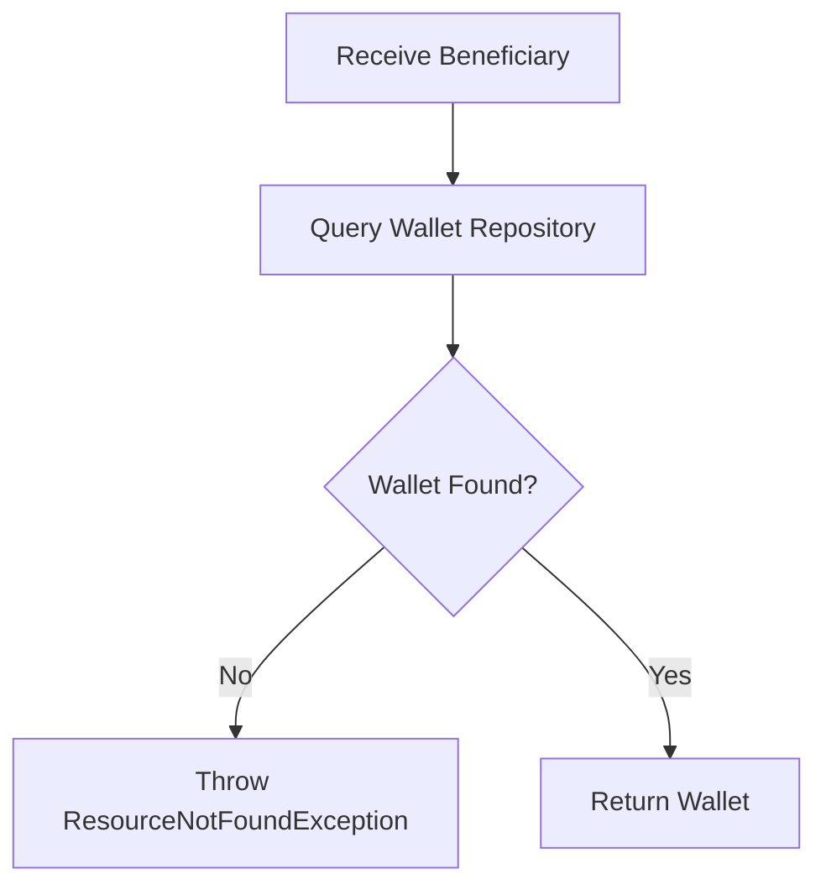

# Method: `findWalletByBeneficiary(BeneficiaryEntity beneficiary)`

## Overview

Retrieves the wallet associated with a beneficiary.

This method is used internally by the Wallet Service whenever a financial operation needs to access a beneficiary's wallet. Since every beneficiary owns exactly one wallet, this method guarantees that all wallet operations are performed against the correct wallet.

If no wallet exists, the operation cannot continue.

---

## Why Do We Need This Method?

Almost every wallet operation begins by locating the beneficiary's wallet.

Examples:

- Credit wallet after settlement
- Debit wallet manually
- Create a wallet hold before payout
- View current wallet balance
- Calculate available balance
- Validate sufficient funds

Instead of duplicating repository logic throughout the service, a single method is responsible for retrieving and validating the wallet.

---

## Business Scenario

A customer successfully completes a payment.

The Settlement Service now needs to credit the nutritionist's wallet.

Before crediting the wallet, the system must first determine which wallet belongs to the beneficiary.

```
Payment Completed
        │
        ▼
Settlement Service
        │
        ▼
findWalletByBeneficiary()
        │
        ▼
Wallet Found
        │
        ▼
Credit Wallet
```

Without locating the wallet, settlement cannot proceed.

---

## Execution Flow



---

## Step-by-Step Execution

### Step 1 - Receive Beneficiary

The service receives a valid beneficiary.

```java
WalletEntity wallet =
        walletService.findWalletByBeneficiary(beneficiary);
```

Example

| Property | Value |
|----------|-------|
| Beneficiary Reference | BEN01K8F6ABCD123456789XYZ |
| Name | Dr. John |
| Status | ACTIVE |

---

### Step 2 - Query Database

The repository searches for the wallet.

```java
walletRepository.findByBeneficiary(beneficiary);
```

SQL Conceptually

```sql
SELECT *
FROM wallets
WHERE beneficiary_id = ?
```

---

### Step 3 - Wallet Exists?

If the repository returns a wallet

```
Wallet Found

↓

Return Wallet
```

Otherwise

```
Wallet Not Found

↓

Throw ResourceNotFoundException
```

---

## Database Interaction

### Query

```
Table

wallets
```

Example

| wallet_reference | beneficiary_id | available_balance |
|------------------|---------------:|------------------:|
| WAL01K8G123ABCDEF987654XYZ | 15 | 250.00 |

---

## Returned Wallet

Example

| Property | Value |
|----------|-------|
| Wallet Reference | WAL01K8G123ABCDEF987654XYZ |
| Beneficiary | BEN01K8F6ABCD123456789XYZ |
| Available Balance | $250.00 |
| Pending Balance | $40.00 |
| Total Credited | $1,200.00 |
| Total Debited | $910.00 |
| Status | ACTIVE |

---

## Balance Changes

None.

This method only retrieves data.

No balances are modified.

---

## Wallet Transactions

No wallet transaction is created.

Reason:

This method performs a read-only operation.

No money enters or leaves the wallet.

---

## Exception Scenarios

### Wallet Not Found

```
Beneficiary

↓

No Wallet Exists

↓

ResourceNotFoundException
```

Example

```text
Wallet not found for beneficiary BEN01K8F6ABCD123456789XYZ
```

---

## Why Doesn't This Method Create a Wallet?

This method intentionally does **not** create a wallet if one does not exist.

Reason:

Automatically creating a wallet could hide onboarding issues and lead to inconsistent financial data.

Wallet creation must occur explicitly through:

```java
createWallet(beneficiary)
```

This ensures that the beneficiary onboarding process remains controlled and predictable.

---

## Where Is This Method Used?

This method is typically called before:

- `creditWallet()`
- `debitWallet()`
- `createWalletHold()`
- `getWalletBalance()`
- `SettlementService`
- `PayoutService`

---

## Summary

`findWalletByBeneficiary()` is the primary lookup method for the Wallet Service. It retrieves the wallet associated with a beneficiary and guarantees that subsequent financial operations are performed against the correct wallet. Since it is a read-only operation, it does not modify balances or create wallet transactions.
